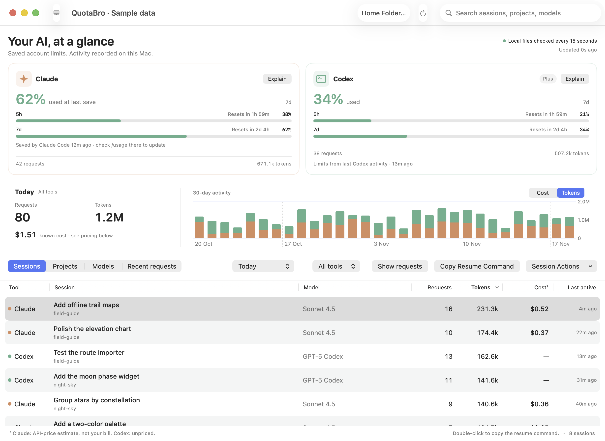

# QuotaBro for macOS and Windows

Track Claude Code, Codex, and Cursor usage in your Mac menu bar. Check account limits and reset times, then open the dashboard to see which sessions, projects, and models used the most tokens on this Mac.

**[Download QuotaBro for Mac](https://github.com/mascarock/QuotaBro-downloads/releases/latest/download/QuotaBro.dmg)** · [Release notes](https://github.com/mascarock/QuotaBro-downloads/releases/latest) · [SHA-256 checksum](https://github.com/mascarock/QuotaBro-downloads/releases/latest/download/SHA256SUMS)

## Windows

QuotaBro for Windows sits in the notification area by the clock, with the same popup and dashboard.

**[Download QuotaBro for Windows (64-bit)](https://github.com/mascarock/QuotaBro-downloads/releases/download/windows-v0.3.3/aiusage-tray-0.3.3-windows-amd64.zip)** · [Windows on Arm](https://github.com/mascarock/QuotaBro-downloads/releases/download/windows-v0.3.3/aiusage-tray-0.3.3-windows-arm64.zip) · [Release notes](https://github.com/mascarock/QuotaBro-downloads/releases/tag/windows-v0.3.3) · [SHA-256 checksums](https://github.com/mascarock/QuotaBro-downloads/releases/download/windows-v0.3.3/SHA256SUMS)

Unzip the download and run **QuotaBro.exe**. It requires Windows 10 or 11 and the Microsoft Edge WebView2 Runtime, which both already include. The Windows build isn't code-signed yet: if SmartScreen says "Windows protected your PC", click **More info**, then **Run anyway**. For Claude limits, sign in to Claude Code once with `claude` and `/login`. A command-line `aiusage.exe` is attached to the same release.

## Prototype screenshots

These four screens show the Mac App Store prototype with fictional sessions, project paths and usage figures.

[Usage breakdown](screenshots/02-QuotaBro-explain.png) · [Session requests](screenshots/03-QuotaBro-requests.png) · [Menu bar panel](screenshots/04-QuotaBro-panel.png) · [Download all four screenshots (ZIP)](https://raw.githubusercontent.com/mascarock/QuotaBro-downloads/main/screenshots/QuotaBro-prototype-preview.zip)

## Install

Requires macOS 15 or later on Apple silicon or Intel. Open the DMG, drag **QuotaBro** to **Applications**, then launch it from Applications. Vibefy LLC signs the app and Apple notarizes the download.

## Usage data

Claude Code and Codex session transcripts stay on your Mac. QuotaBro reads your Claude Code login from Keychain to fetch account limits from Anthropic. If you connect Cursor, QuotaBro stores your session cookie in Keychain and requests usage from Cursor. Dollar estimates use API list prices.
